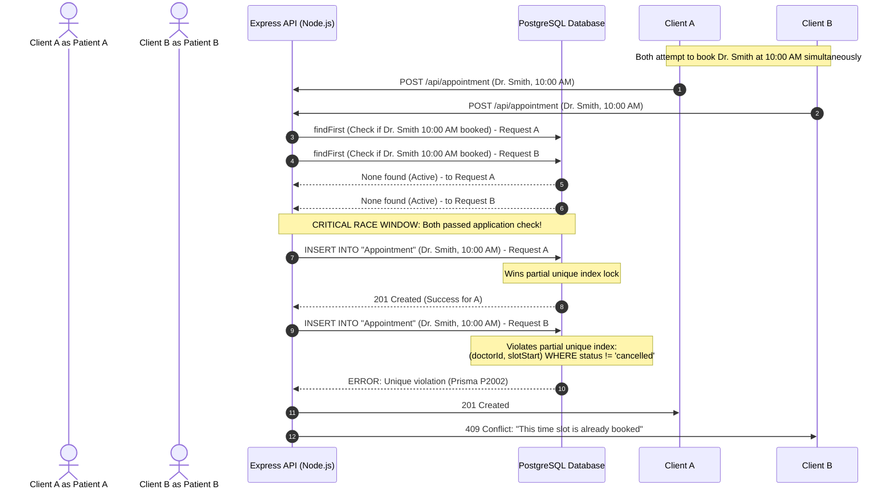

# Juspay SDE-1 Final Round Interview Preparation Guide & Knowledge Base

> **Context:** Comprehensive preparation guide for the Juspay SDE-1 final onsite interview (following Hackathon Part B). Contains full architectural breakdowns, model answers, active-recall hints, and an extensive deep-dive into database design and concurrency control (both theoretical and grounded in this repository's codebase).

---

## Table of Contents
1. [Project Deep-Dive Questions & Model Answers](#1-project-deep-dive-questions--model-answers)
2. [Scalability & System Architecture](#2-scalability--system-architecture)
3. [Database Design & Concurrency Deep Dive](#3-database-design--concurrency-deep-dive)
   - [Core Database Interview Questions & Model Answers](#core-database-interview-questions--model-answers)
   - [Codebase Case Study: Database Architecture in Patient-Tracker](#codebase-case-study-database-architecture-in-patient-tracker)
4. [Core CS Fundamentals (OS, Networking, Concurrency & Part B)](#4-core-cs-fundamentals-os-networking-concurrency--part-b)
5. [Behavioral & Cultural Alignment (STAR Framework)](#5-behavioral--cultural-alignment-star-framework)

---

## 1. Project Deep-Dive Questions & Model Answers

### Architecture Decisions & Alternatives Considered

#### Q1: Can you walk me through the high-level architecture of your primary project and explain why you chose this specific topology?
- **Active Recall Hint:** Flow from client request to data store; modularity, throughput requirements, and developer velocity.
- **Model Answer:**
  > A strong answer breaks the system into distinct tiers: Client (SPA/Mobile) $\to$ Reverse Proxy / API Gateway (TLS termination, rate limiting, routing) $\to$ Stateless Application Server Layer $\to$ Persistence Layer (Relational DB, In-memory Cache, Message Broker).
  > 
  > *Example justification:* "We adopted a modular three-tier client-server architecture. The backend is completely stateless, externalizing all session and auth verification to JWT tokens verified via middleware. This allows horizontal autoscaling behind a reverse proxy. Data requiring strict relational consistency (users, appointments, financial records) sits in PostgreSQL, while ephemeral or volatile data sits in Redis. This topology strikes the optimal balance between high velocity, zero-downtime deployment capabilities, and data integrity without the operational complexity of microservices."

#### Q2: What alternative architecture did you evaluate (e.g., monolith vs. microservices, event-driven vs. synchronous REST), and what disqualified it?
- **Active Recall Hint:** Concrete trade-offs: deployment overhead, operational complexity, network latency budgets, or data consistency constraints.
- **Model Answer:**
  > "We evaluated decomposing the domain into discrete microservices (e.g., Auth Service, Scheduling Service, Notification Service). However, we disqualified it for three key reasons:
  > 1. **Distributed Transaction Overhead:** Workflows like booking an appointment and generating notifications would require distributed sagas or two-phase commits to maintain consistency across boundaries.
  > 2. **Network Hop Latency:** Inter-service RPC adds serialization and network latency, impacting strict p99 latency targets.
  > 3. **Operational Drag:** Managing multiple deployment pipelines, container registries, service meshes, and distributed tracing was unjustified for our team size and traffic volume. A modular monolith offered clean domain boundaries with zero network overhead."

#### Q3: Where are the synchronous and asynchronous boundaries in your architecture, and why?
- **Active Recall Hint:** Critical path user interactions vs. deferred background jobs, dead-letter queues, and perceived latency.
- **Model Answer:**
  > "Synchronous communication is strictly reserved for the **user-facing critical path**—operations where the client cannot proceed without immediate deterministic confirmation (e.g., user authentication, checking slot availability, writing a database record with immediate validation).
  > 
  > Asynchronous boundaries are established for **side-effects and non-blocking tasks**: email/SMS reminder dispatches, push notifications, audit logging, analytics ingestion, and report generation. These are offloaded to background worker queues (e.g., BullMQ/Redis or RabbitMQ) with exponential backoff and dead-letter queues (DLQs). This isolates the primary API from downstream latency spikes and guarantees fault isolation."

#### Q4: How did you enforce separation of concerns across service/domain boundaries?
- **Active Recall Hint:** Domain boundaries, decoupled contracts, interface abstraction, and preventing leaky abstractions across layers.
- **Model Answer:**
  > "We structured the codebase using a layered domain-driven approach:
  > - **Transport/Controller Layer:** Strictly handles HTTP request parsing, header extraction, and DTO validation. It contains zero business logic.
  > - **Service/Domain Layer:** Encapsulates pure business rules, domain invariants, and orchestrates actions.
  > - **Data Access Layer (Repository/ORM):** Isolates raw queries, schema mappings, and persistence logic.
  > 
  > Layers communicate through typed interfaces/schemas. Domain models never expose raw database handles to the transport layer, ensuring that changing the persistence store or serialization format doesn't bleed into business logic."

---

### Tooling & Framework Justifications

#### Q5: Why did you choose your primary runtime/framework over competing alternatives?
- **Active Recall Hint:** I/O profile (CPU-bound vs. I/O-bound), concurrency models, ecosystem maturity, and cold start/memory footprints.
- **Model Answer:**
  > "For an I/O-heavy web application with high network concurrency (handling WebSocket chats, REST calls, and database transactions), **Node.js with Express** was selected because of its non-blocking, event-driven single-threaded event loop (libuv). It handles thousands of concurrent idle or waiting I/O connections with minimal memory overhead per connection compared to thread-per-request models (like traditional Tomcat/Java).
  > 
  > *When we would pivot:* If our primary workload shifted from I/O orchestration to CPU-heavy computing (e.g., real-time cryptography, heavy image processing, or graph traversal algorithms), we would transition critical paths to Go or Rust to avoid blocking the Node.js event loop and leverage true multi-core parallel CPU execution."

#### Q6: Why did you choose your specific communication protocol (REST, gRPC, GraphQL, WebSockets) for client-server and inter-service messaging?
- **Active Recall Hint:** Serialization overhead (JSON vs. Protobuf), connection reuse, bidirectional streaming, and query flexibility.
- **Model Answer:**
  > "We adopted a hybrid model based on communication semantics:
  > - **REST (JSON over HTTP/1.1 or HTTP/2):** Standard CRUD APIs, authentication, and administrative actions. High compatibility with browser clients, simple caching via standard HTTP headers (`ETag`, `Cache-Control`), and inspectability.
  > - **WebSockets:** Bidirectional, full-duplex communication for real-time features (such as live chat or instant notification streams), eliminating the round-trip overhead and header bloat of repeated HTTP polling.
  > - **Where gRPC wins:** For internal service-to-service communication under heavy volume, gRPC over HTTP/2 with Protocol Buffers is superior: compact binary serialization (3-10x smaller than JSON), strongly typed schema contracts (.proto), and persistent multiplexed TCP streams."

---

### Failure Modes, Resilience & Retry Policies

#### Q7: What happens if a downstream dependency or external service suffers a 500ms latency spike or goes down completely?
- **Active Recall Hint:** Timeouts, thread/connection pool exhaustion, circuit breakers, and graceful fallback responses.
- **Model Answer:**
  > "Without proper defenses, slow downstream services cause cascading upstream failures: requests queue up, consuming server worker threads/memory, leading to resource exhaustion. We counter this with:
  > 1. **Strict Client-Side Timeouts:** Every outbound call has an explicit timeout budget (e.g., connect timeout: 200ms, read timeout: 800ms).
  > 2. **Circuit Breaker Pattern (e.g., Opossum / Resilience4j):** Tracks failure rates. If errors exceed 50% over a 10-second rolling window, the breaker trips to `OPEN`, immediately failing fast without sending network traffic downstream.
  > 3. **Graceful Degradation / Fallbacks:** For non-critical services (e.g., recommendation or notification engines), the system returns cached data or a stub response while logging a warning."

#### Q8: How do you prevent 'thundering herd' or retry storms when a failed external service recovers?
- **Active Recall Hint:** Exponential backoff with jitter, rate limiters, and server-side request shedding.
- **Model Answer:**
  > "When a failed service restarts, thousands of waiting clients retrying simultaneously will crash it again (a retry storm). We resolve this with:
  > - **Exponential Backoff with Full Jitter:** Instead of fixed retries, wait times scale exponentially ($T = \text{base} \times 2^{\text{attempt}}$) multiplied by a randomized uniform distribution factor $\text{random}(0, 1)$. This spreads request spikes smoothly over time.
  > - **Retry Budgets:** Limit retries to a maximum of 10-20% of total outbound requests. If downstream is struggling, drop retries entirely rather than worsening load.
  > - **Token Bucket Rate Limiting:** Apply rate limiters on the client and server to clip traffic peaks."

#### Q9: How do you guarantee idempotency for critical write operations (such as payment processing or order placement)?
- **Active Recall Hint:** Unique idempotency keys, atomic upserts/locks, deduplication caches, and idempotent state machines.
- **Model Answer:**
  > "At Juspay's scale, network timeouts frequently cause clients to retry requests whose server-side state might already have succeeded. We enforce end-to-end idempotency:
  > 1. **Client Idempotency Key:** The client generates a unique UUID (Idempotency Key) per transaction attempt and sends it in the header (`Idempotency-Key: <UUID>`).
  > 2. **Distributed Cache / DB Lock:** The server checks Redis/Postgres for the key inside an atomic transaction.
  >    - If key does not exist: Save the key with status `IN_PROGRESS` and a TTL.
  >    - If key exists and status is `IN_PROGRESS`: Return HTTP 409 (Conflict) or wait.
  >    - If key exists and status is `COMPLETED`: Return the stored response payload immediately without re-executing the payment logic.
  > 3. **Database-Level Unique Constraints:** A unique index on `transaction_reference_id` ensures that even in the case of a cache miss or race, the database rejects duplicate row insertions."

---

### 10x / 100x Scale Stress-Testing

#### Q10: If incoming read traffic suddenly grew by 10x tomorrow, which component breaks first and how would you mitigate it?
- **Active Recall Hint:** DB connection limits or CPU-bound serialization; read replicas, caching, and connection poolers.
- **Model Answer:**
  > "The primary database would bottleneck first—specifically its connection pool and CPU utilization due to parsing and executing repetitive SELECT queries.
  > 
  > *Mitigation steps:*
  > 1. **Connection Pooling:** Introduce a dedicated pooling proxy like PgBouncer to eliminate connection setup overhead.
  > 2. **In-Memory Caching (Redis):** Cache high-frequency read results (e.g., doctor profiles, available schedules) with a Cache-Aside pattern and TTLs.
  > 3. **Read Replicas:** Route read-only queries to asynchronous PostgreSQL read replicas via a load-balanced read endpoint, reserving the primary master solely for write operations."

#### Q11: If write traffic increased by 100x, how would your data ingestion pipeline need to change?
- **Active Recall Hint:** Transition from synchronous DB writes to message broker buffering (Kafka/RabbitMQ) with batched consumer persistence.
- **Model Answer:**
  > "Synchronous ACID database writes will fail under a 100x write surge because disk I/O, WAL (Write-Ahead Logging), and lock contention become the hard ceiling.
  > 
  > *Transformation to Asynchronous Ingestion:*
  > 1. **Decouple with a Distributed Commit Log (Apache Kafka):** Ingest incoming write payloads into partitioned Kafka topics. Kafka handles append-only sequential disk writes, easily absorbing hundreds of thousands of events per second.
  > 2. **Batched Consumer Writers:** Consumer worker services pull batches of events from Kafka (e.g., 500 records at a time) and perform bulk upserts (`INSERT INTO ... VALUES (...) ON CONFLICT DO NOTHING`) against the database.
  > 3. **Database Sharding:** Horizontally partition (shard) the database by a high-cardinality shard key (e.g., `user_id` or `tenant_id`) so writes distribute across independent database instances."

---

### Retrospective & Engineering Maturity

#### Q12: Looking back at your project today, what is the single biggest architectural flaw or regret you would redesign from scratch?
- **Active Recall Hint:** Demonstrate self-critical engineering maturity; highlight a real bottleneck or coupling issue and outline a superior design.
- **Model Answer:**
  > "In early versions, we relied on in-process scheduling and cron tasks directly on the application servers (using libraries like `node-cron`). When we scaled horizontally to multiple instances, each node ran identical scheduled tasks simultaneously, causing duplicate reminder dispatches and database lock collisions.
  > 
  > *How I redesigned it:* We externalized task scheduling by introducing a centralized distributed task scheduler backed by Redis (BullMQ) with atomic job locking, ensuring exactly-once execution across horizontal workers."

---

## 2. Scalability & System Architecture

### Horizontal vs. Vertical Scaling Trade-offs

#### Q13: When does vertical scaling cease to be viable, and what operational complexities emerge when you switch to horizontal scaling?
- **Active Recall Hint:** Hardware cost curves and physical CPU/RAM limits vs. distributed state management, tracing, and network latency.
- **Model Answer:**
  > - **Vertical Scaling (Scale-Up):** Adding more CPU cores, RAM, and NVMe SSDs to a single machine. It is simple (no code changes required, zero distributed data consistency problems). However, it hits a hard ceiling: extreme hardware costs (exponential price curve at top specs), single point of failure (SPOF), and physical motherboard limits.
  > - **Horizontal Scaling (Scale-Out):** Adding multiple standard commodity machines behind a load balancer. It provides near-infinite scale and high availability.
  > - **Operational Complexities Introduced:**
  >   1. **State Externalization:** Sessions, caches, and file storage must move out of the local server memory/disk to distributed systems (Redis, S3).
  >   2. **Distributed Consistency:** Concurrent requests hitting different nodes can see stale data unless synchronization or read-your-writes consistency is enforced.
  >   3. **Network Latency & Failures:** Partial network partitions, distributed tracing requirements, and service discovery overhead.

---

### Bottleneck Identification & Live Profiling

#### Q14: A service's p99 latency spikes from 30ms to 2.5s under peak load while CPU utilization sits at only 25%. How do you diagnose the root cause?
- **Active Recall Hint:** Thread contention/blocking, lock wait times, database connection pool exhaustion, synchronous network I/O, or GC pauses.
- **Model Answer:**
  > "Low CPU utilization combined with high latency is the classic signature of **blocking waits / thread starvation**, not CPU saturation. Diagnostic steps:
  > 1. **Check Connection Pools:** Inspect database and HTTP connection pool metrics (`active_connections` vs `max_connections`). If threads are blocked waiting for an available DB connection from the pool, p99 spikes while CPU remains idle.
  > 2. **Database Lock Contention:** Query `pg_stat_activity` and `pg_locks` in PostgreSQL to see if concurrent transactions are waiting on row-level or table-level locks (`exclusive_lock`, `tuple_lock`).
  > 3. **Downstream Synchronous I/O:** Look at APM distributed traces (OpenTelemetry) to identify if an external API call or slow DNS lookup is blocking request threads.
  > 4. **Garbage Collection Pauses:** In JVM or V8 runtimes, check GC logs for Stop-The-World (STW) pauses causing thread freezing."

#### Q15: What is the difference between average latency and tail latency (p95/p99/p99.9), and why does tail latency dictate user experience at scale?
- **Active Recall Hint:** Multi-call fanout amplification: one user action triggering tens of backend calls where the slowest bounds total latency.
- **Model Answer:**
  > "Average latency hides outliers—if 99 users experience 10ms and 1 user experiences 10,000ms, the average is ~110ms, which looks acceptable on a dashboard.
  > 
  > **Tail Latency (p99/p99.9):** Represents the latency experienced by the worst 1% or 0.1% of requests.
  > **Why it dominates at scale:** In modern microservices, a single client request often fans out into 20-50 backend calls (e.g., auth, permissions, cart, inventory, pricing). If each backend call has a 99% success rate under 50ms, the probability that the composite user request completes without hitting a 99th-percentile outlier drops significantly:
  > $$P(\text{all 50 calls } \le p99) = 0.99^{50} \approx 60.5\%$$
  > Meaning ~40% of end-user requests will experience the worst-case tail latency."

---

### Caching Strategies & Cache Invalidation

#### Q16: Compare Cache-Aside, Write-Through, Write-Behind (Write-Back), and Refresh-Ahead.
- **Active Recall Hint:** Contrast data freshness, read/write latency, risk of data loss on failure, and implementation complexity.
- **Model Answer:**
  | Strategy | How it Works | Pros | Cons / Risks |
  | :--- | :--- | :--- | :--- |
  | **Cache-Aside** *(Lazy Loading)* | App checks cache; on miss, reads DB and populates cache. Writes update DB and invalidate/update cache. | Resilient to cache crashes; cache only holds requested keys. | Cache miss penalty (3 network hops); potential stale data if invalidation fails. |
  | **Write-Through** | App writes to cache; cache synchronously writes to DB before acknowledging. | High data consistency between cache and DB; read queries are always fresh. | Higher write latency (two synchronous writes). |
  | **Write-Behind** *(Write-Back)* | App writes to cache; cache immediately returns success and asynchronously flushes batches to DB. | Ultra-low write latency; handles extreme write bursts. | **Risk of permanent data loss** if cache crashes before flushing to disk. |
  | **Refresh-Ahead** | Cache automatically refreshes hot keys in the background before their TTL expires. | Eliminates cache miss latency for hot keys. | Hard to predict exact access patterns; wasteful if keys are not re-read. |

#### Q17: Explain Cache Stampede, Cache Penetration, and Cache Breakdown, and how to prevent each.
- **Active Recall Hint:** Stampede/Breakdown: mutex/distributed locking; Penetration: Bloom filters or caching empty/null values.
- **Model Answer:**
  > 1. **Cache Breakdown (Hotspot Invalidation):**
  >    - *What happens:* A single ultra-hot key expires. Thousands of concurrent requests miss the cache simultaneously and slam the database.
  >    - *Defense:* **Mutex Lock:** Only the first thread that misses acquires a distributed lock (e.g., Redis `SET NX`) to query the DB and update the cache; all other threads wait or poll. Alternatively, use probabilistic early expiration (XFetch algorithm).
  > 2. **Cache Penetration (Non-Existent Keys):**
  >    - *What happens:* Malicious or bug-driven queries request IDs that do *not exist* in either cache or DB, forcing every query to hit the DB.
  >    - *Defense:*
  >      - **Cache Null Objects:** Store `key: null` with a short TTL (e.g., 60 seconds).
  >      - **Bloom Filter:** A space-efficient probabilistic data structure placed in front of the cache. If the Bloom filter says the key does not exist, reject the request immediately without touching DB or cache.
  > 3. **Cache Stampede (Avalanche):**
  >    - *What happens:* Many keys expire at the exact same second (e.g., midnight batch or identical TTLs), overloading the database.
  >    - *Defense:* **Jittered TTLs:** Add random variation to expiration times: $\text{TTL} = \text{base\_ttl} + \text{random}(0, 300\text{s})$.

---

### Load Balancing Approaches

#### Q18: Compare Layer 4 vs. Layer 7 Load Balancing.
- **Active Recall Hint:** Packet-level TCP proxying vs. HTTP header/cookie inspection and routing.
- **Model Answer:**
  > - **Layer 4 (Transport Layer - TCP/UDP):**
  >   - Operates on IP address and port without inspecting application payload.
  >   - Extremely fast and CPU-efficient (often implemented with Linux IPVS or HAProxy in TCP mode).
  >   - Cannot route based on HTTP headers, cookies, or URL paths; cannot terminate SSL at the application level.
  > - **Layer 7 (Application Layer - HTTP/HTTPS/gRPC):**
  >   - Terminates the TCP connection, decrypts TLS, parses HTTP headers, cookies, and pathnames.
  >   - Intelligent routing: can route `/api/v1/payments` to Payment cluster and `/api/v1/users` to User cluster; supports sticky sessions via cookies.
  >   - Higher CPU and memory overhead due to TLS decryption and packet buffering.

#### Q19: How does Consistent Hashing work, and why is it essential for distributed caching?
- **Active Recall Hint:** Hash ring ($0$ to $2^{32}-1$); virtual nodes preventing cascading key remapping when nodes join/leave.
- **Model Answer:**
  > - **Traditional Modulo Hashing ($\text{hash}(key) \pmod N$):** When the number of nodes $N$ changes (a server crashes or a new one is added), almost all keys ($1 - 1/N$) remap to different servers, causing an immediate 100% cache miss catastrophe.
  > - **Consistent Hashing:** Maps both server nodes and cache keys onto a continuous hash ring ($0$ to $2^{32}-1$). A key is assigned to the first server node encountered moving clockwise.
  >   - **When a node is added/removed:** Only keys belonging to the immediate neighbor segment are remapped ($K/N$ keys), leaving all other nodes untouched.
  >   - **Virtual Nodes:** To prevent hotspotting / data skew, each physical server is assigned multiple virtual tokens on the ring, ensuring uniform hash distribution.

---

## 3. Database Design & Concurrency Deep Dive

### Core Database Interview Questions & Model Answers

#### Q20: How does a B+ Tree index physically organize data, and why is it preferred over Hash Indexes or standard B-Trees in relational databases?
- **Active Recall Hint:** Range-scan efficiency (linked leaf nodes), fixed tree height, high fan-out minimizing disk I/O.
- **Model Answer:**
  > - **Structure:** In a B+ Tree, internal nodes store *only* routing keys and child page pointers. **All data pointers / row data reside exclusively in leaf nodes**. Furthermore, all leaf nodes are connected via a doubly-linked list.
  > - **Why preferred over Hash Indexes:** Hash indexes provide $O(1)$ point lookups, but are completely incapable of range queries (`WHERE age BETWEEN 20 AND 30` or `ORDER BY created_at`). B+ Trees execute range scans in $O(\log N + K)$ by locating the start key and traversing leaf links sequentially.
  > - **Why preferred over standard B-Trees:** In standard B-trees, data is stored in both internal and leaf nodes. Because internal nodes hold heavy row data, fewer keys fit in a single disk block, resulting in lower fan-out and a taller tree (requiring more random disk I/Os). In B+ Trees, high fan-out keeps tree depth to 3-4 levels for billions of rows, fitting upper levels entirely in RAM cache.

#### Q21: What is a Composite Index, the "Leftmost Prefix Rule", and a Covering Index?
- **Active Recall Hint:** Column order in index `(A, B, C)`; index-only scan avoiding table lookup / disk hop.
- **Model Answer:**
  > - **Composite Index:** An index on multiple columns, e.g., `CREATE INDEX idx_user ON users(country, status, created_at)`.
  > - **Leftmost Prefix Rule:** The B+ Tree sorts keys hierarchically: first by `country`, then by `status`, then by `created_at`.
  >   - A query with `WHERE country = 'IN' AND status = 'ACTIVE'` uses the index efficiently.
  >   - A query with `WHERE status = 'ACTIVE'` **cannot** use the index because the tree is not sorted by `status` at the root level.
  > - **Covering Index:** When an index contains *all* the columns requested by the `SELECT` and `WHERE` clauses (e.g., `SELECT status FROM users WHERE country = 'IN'`). The query engine satisfies the request entirely from the B+ Tree index in RAM without making a secondary "bookmark lookup" to the physical table heap on disk.

#### Q22: When does adding an index actively degrade system performance instead of helping?
- **Active Recall Hint:** Write-heavy workloads, low-cardinality columns (boolean flags), tiny tables, and memory/buffer bloat.
- **Model Answer:**
  > 1. **High Write/Update Throughput:** Every `INSERT`, `UPDATE`, and `DELETE` must rebalance the B+ Tree, split index pages, and write to the WAL for *every* index on that table.
  > 2. **Low Cardinality Columns:** Columns with very few distinct values (e.g., `gender`, `is_active = true/false`). The query planner will choose a sequential table scan over an index scan because random index traversal cost exceeds sequential disk block reads.
  > 3. **Small Tables:** Tables fitting in a few disk blocks (e.g., status lookup tables) are faster to scan sequentially than paying index traversal overhead.
  > 4. **Memory Footprint:** Indexes consume space in the database buffer pool (`shared_buffers`), crowding out cached table data.

#### Q23: Compare Pessimistic Locking (`SELECT ... FOR UPDATE`) vs. Optimistic Locking (Versioning/CAS).
- **Active Recall Hint:** Pessimistic locks upfront (high contention, risk of deadlocks); Optimistic validates on commit (low contention, abort/retry).
- **Model Answer:**
  > - **Pessimistic Locking:**
  >   - *Mechanism:* Acquires an exclusive lock on the row before reading/modifying: `SELECT * FROM accounts WHERE id = 1 FOR UPDATE;`. Other transactions attempting to read with `FOR UPDATE` or write to this row block until the transaction commits or rolls back.
  >   - *When to use:* High concurrency contention where conflicts are frequent and re-running failed transactions is expensive (e.g., high-stakes financial balance deductions).
  >   - *Drawback:* Severe throughput bottleneck; risk of deadlocks if locks are acquired in inconsistent order.
  > - **Optimistic Locking:**
  >   - *Mechanism:* Assumes conflicts are rare. Reads the row alongside a `version` column. When updating:
  >     ```sql
  >     UPDATE accounts 
  >     SET balance = balance - 50, version = version + 1 
  >     WHERE id = 1 AND version = 5;
  >     ```
  >   - If `rows_affected == 0`, a concurrent transaction modified the row first; the application aborts and retries.
  >   - *When to use:* Read-heavy systems with low-to-medium write contention. High throughput with zero database lock waiting.

#### Q24: Explain the four ANSI SQL Transaction Isolation Levels and their concurrency anomalies.
- **Active Recall Hint:** Hierarchy from Read Uncommitted $\to$ Serializable; Dirty Read, Non-repeatable Read, Phantom Read, Write Skew.
- **Model Answer:**
  | Isolation Level | Dirty Read | Non-repeatable Read | Phantom Read | Mechanism / Trade-off |
  | :--- | :---: | :---: | :---: | :--- |
  | **Read Uncommitted** | Allowed | Allowed | Allowed | Reads uncommitted changes of other transactions. Never used in production. |
  | **Read Committed** | **Prevented** | Allowed | Allowed | Reads only committed data. Each SELECT sees a new snapshot of committed data. (PostgreSQL/Oracle default). |
  | **Repeatable Read** | **Prevented** | **Prevented** | Prevented (in Postgres MVCC) | Transaction snapshot is fixed at the start of the transaction. Successive reads return identical data. |
  | **Serializable** | **Prevented** | **Prevented** | **Prevented** | Guarantees that concurrent transactions produce results identical to some serial execution. Uses S2PL (Strict 2-Phase Locking) or SSI (Serializable Snapshot Isolation). |

---

### Codebase Case Study: Database Architecture in Patient-Tracker

To illustrate these principles in practice, let us examine how the database is structured, used, and protected against concurrency bugs in this repository.

#### 1. What it is
The system utilizes **PostgreSQL** interfaced through the **Prisma ORM** ([backend/prisma/schema.prisma](file:///e:/dev/patient-tracker/backend/prisma/schema.prisma)). The schema models healthcare workflows with strong relational integrity:
- **Core Entities:** `Patient`, `Doctor`, `Appointment`, `MedicalRecord`, `Prescription`, `PrescribedMedicine`, `Chat`, `Message`, `MedicineAdherence`, `HealthMetrics`.
- **Identity Strategy:** Mixed primary key strategy:
  - `Patient` uses an auto-incrementing integer (`Int @id @default(autoincrement())`) for clean internal referencing.
  - `Doctor`, `Appointment`, and `Prescription` use globally unique UUIDs (`String @id @default(uuid())`) to prevent ID enumeration and facilitate distributed generation.
- **Relational Integrity:** Strict foreign key relations with cascading constraints (e.g., `PrescribedMedicine` tied directly to `Prescription`, `MedicalRecord` tied to `Patient`).

#### 2. How it is used
- **Query Layer:** Data operations are executed via Prisma client queries (`prisma.patient.findFirst`, `prisma.appointment.create`), leveraging prepared statements to eliminate SQL injection.
- **Dynamic Scheduling:** Appointments are normalized to hourly slot boundaries (`slotStart`) calculated dynamically via date utility functions.
- **Fast-Path Verification:** Before inserting, the application executes a fast-path read check:
  ```javascript
  // Fast-path read check in backend/appointment/createAppointment.js
  const conflictingAppointment = await prisma.appointment.findFirst({
    where: {
      doctorId: doctorIdStr,
      slotStart,
      status: { not: "cancelled" },
    },
  });
  if (conflictingAppointment) {
    return res.status(409).json({ error: "This time slot is already booked" });
  }
  ```

#### 3. Why it is used & Concurrency Guard Architecture



##### The Race Condition Problem
In appointment booking and payment allocation, an application-level check (`if (!conflictingAppointment)`) is subject to a classic **Time-of-Check to Time-of-Use (TOCTOU)** race condition. If two requests arrive within milliseconds:
1. Thread A executes `findFirst` $\to$ Returns empty (no booking).
2. Thread B executes `findFirst` $\to$ Returns empty (no booking).
3. Thread A executes `create` $\to$ Inserts appointment.
4. Thread B executes `create` $\to$ Inserts duplicate appointment for the same doctor and time slot.

##### The Solution: PostgreSQL Partial Unique Index
Rather than using expensive distributed table locks, the system enforces a **database-level Partial Unique Index**:
```sql
CREATE UNIQUE INDEX "idx_unique_active_doctor_slot" 
ON "Appointment" ("doctorId", "slotStart") 
WHERE status <> 'cancelled';
```
- **Why it is superior:**
  1. **Zero Double Booking:** The database engine's B+ Tree enforces atomic serialization at write time. Exactly one write wins; the other receives constraint violation `P2002`.
  2. **Re-bookability of Cancelled Slots:** By making the index *partial* (`WHERE status <> 'cancelled'`), cancelled appointments remain in the table for historical auditing while freeing the slot for new bookings.
  3. **Graceful Handling in Code:**
     ```javascript
     // createAppointment.js L76-L81
     } catch (error) {
       if (error instanceof Prisma.PrismaClientKnownRequestError && error.code === "P2002") {
         return res.status(409).json({ error: "This time slot is already booked" });
       }
       return res.status(500).json({ error: "Failed to create appointment" });
     }
     ```

---

## 4. Core CS Fundamentals (OS, Networking, Concurrency & Part B)

### Operating Systems: Processes, Threads & Memory

#### Q25: What physically happens inside the CPU and OS kernel during a context switch between two threads in the same process versus different processes?
- **Active Recall Hint:** Shared virtual address space vs. swapping page directories and flushing the TLB (Translation Lookaside Buffer).
- **Model Answer:**
  > - **Thread Switch (Same Process):**
  >   - The OS saves the CPU register state (Program Counter, Stack Pointer, General-purpose registers) of the outgoing thread into its Thread Control Block (TCB).
  >   - Loads the register state of the incoming thread from its TCB.
  >   - *Crucial difference:* Both threads share the exact same virtual memory address space. The Page Table root pointer (`CR3` register in x86) remains untouched, and the **TLB (Translation Lookaside Buffer) is NOT flushed**, keeping memory cache access hot and fast.
  > - **Process Switch (Different Processes):**
  >   - Saves CPU register state into the Process Control Block (PCB).
  >   - Changes the memory mapping by writing the new process's Page Table physical address to the `CR3` register.
  >   - **Invalidates/flushes the TLB cache**. The CPU experiences massive cache misses as it re-resolves virtual-to-physical address translations through multi-level page table walks in RAM.

#### Q26: How does Virtual Memory paging work, and what distinguishes a Minor Page Fault from a Major Page Fault?
- **Active Recall Hint:** Minor: page is in physical RAM but missing MMU mapping; Major: page must be fetched from disk swap space.
- **Model Answer:**
  > - Virtual memory breaks address space into fixed-size chunks (typically 4KB pages) mapped to physical frames via multi-level Page Tables.
  > - **Minor Page Fault:** The requested memory page is already loaded in physical RAM (e.g., shared library loaded by another process, or allocated memory not yet mapped into the process's MMU page table). The OS kernel simply updates the page table entry. Cost: a few microseconds, zero disk I/O.
  > - **Major Page Fault:** The requested page is *not* in physical RAM; it has been paged out to disk swap or is being read from a memory-mapped file. The thread is put to sleep while the OS initiates blocking disk I/O to transfer the page into RAM. Cost: 5-10 milliseconds (thousands of times slower).

---

### Networking: OSI, TCP/IP, HTTP/HTTPS & WebSockets

#### Q27: Detail the TCP 3-Way Handshake, 4-Way Teardown, and why the `TIME_WAIT` state is necessary.
- **Active Recall Hint:** `SYN`, `SYN-ACK`, `ACK`; `FIN`, `ACK`, `FIN`, `ACK`; `TIME_WAIT` ($2 \times \text{MSL}$) prevents delayed packet collisions.
- **Model Answer:**
  > - **Handshake:**
  >   1. Client sends `SYN (seq=x)`.
  >   2. Server replies `SYN-ACK (seq=y, ack=x+1)`.
  >   3. Client sends `ACK (ack=y+1)`. Connection is now `ESTABLISHED`.
  > - **Teardown:**
  >   1. Initiator sends `FIN`.
  >   2. Receiver sends `ACK` (half-closed).
  >   3. Receiver finishes sending data and sends `FIN`.
  >   4. Initiator sends `ACK` and enters `TIME_WAIT`.
  > - **Why `TIME_WAIT` is critical (2 MSL - Maximum Segment Lifetime, typically 60-120s):**
  >   1. Ensures the final `ACK` is received by the remote server. If the final `ACK` is lost, the server retransmits `FIN`, which the client can only re-ACK if still in `TIME_WAIT`.
  >   2. Allows lingering or duplicate packets from the old connection to die out in the network so they do not corrupt a newly opened socket on the same IP/port tuple.

#### Q28: How does TLS 1.3 achieve 1-RTT Handshake compared to TLS 1.2's 2-RTT?
- **Active Recall Hint:** Diffie-Hellman key share guessed and bundled directly in the initial `ClientHello` message.
- **Model Answer:**
  > - **TLS 1.2 (2-RTT):** Client and server first exchange supported cipher suites (`ClientHello` / `ServerHello`), then exchange certificates and Diffie-Hellman parameters, and only after 2 round-trips derive the symmetric key to send encrypted application data.
  > - **TLS 1.3 (1-RTT):** Client assumes a modern key-exchange algorithm (e.g., X25519) and sends its Diffie-Hellman key share *directly inside the initial `ClientHello`*. The server responds with its own key share and certificate in `ServerHello`. Both sides compute the shared symmetric encryption key immediately, allowing application data to flow on the very next packet.

---

### Concurrency & Hackathon Part B Tie-Ins

#### Q29: What are the four Coffman conditions for Deadlock, and how did you prevent them in your Hackathon Part B tree-locking solution?
- **Active Recall Hint:** Mutual Exclusion, Hold & Wait, No Preemption, Circular Wait; eliminated Circular Wait via strict hierarchical lock ordering.
- **Model Answer:**
  > - **The 4 Coffman Conditions:**
  >   1. *Mutual Exclusion:* Resources cannot be shared simultaneously.
  >   2. *Hold and Wait:* A process holds at least one resource while waiting to acquire another.
  >   3. *No Preemption:* A resource cannot be forcibly confiscated from a thread.
  >   4. *Circular Wait:* A closed chain of threads exists such that each thread holds a lock needed by the next thread.
  > - **Deadlock Elimination in Part B (Tree Locking):**
  >   - To break the **Circular Wait** condition, enforce a **Strict Global Lock Ordering**.
  >   - *Mechanism:* When acquiring locks on multiple tree nodes (e.g., checking ancestors from node to root or locking descendants during an `upgrade` operation), always acquire locks in sorted order of unique Node IDs or strictly top-down (root-to-leaf) / bottom-up (leaf-to-root). Two concurrent threads locking intersecting paths will compete for the first common node in the same sequence, guaranteeing no circular deadlock cycle can form.

#### Q30: How do Reader-Writer Locks (`shared_mutex`) prevent writer starvation vs. reader starvation in hierarchical structures?
- **Active Recall Hint:** Fair queuing / writer-preference policies prevent incoming readers from indefinitely postponing a waiting writer.
- **Model Answer:**
  > - In a read-heavy tree, thousands of threads continuously acquire read locks (`shared_lock`). Under a naive reader-preference policy, a thread wishing to write (e.g., lock a node or upgrade) waits indefinitely because there is always at least one active reader (Writer Starvation).
  > - **Writer-Preference / Fair Lock:** As soon as a writer requests an exclusive lock, subsequent incoming readers are queued behind the writer. Once the currently active readers release their locks, the writer executes immediately before queued readers are unblocked.

---

## 5. Behavioral & Cultural Alignment (STAR Framework)

### Aligning with Juspay's Engineering Philosophy

#### Q31: "Why Juspay?" — How do you connect your engineering passion with Juspay's scale and functional programming paradigms?
- **Model STAR Blueprint:**
  > - **Situation:** I love building systems where performance and correctness are non-negotiable mathematical requirements rather than afterthoughts.
  > - **Task:** Juspay processes over 100 million transactions a day with ultra-low latency, building foundational payment rails using functional programming (Haskell, PureScript) and zero-defect architecture.
  > - **Action:** During my engineering projects and the Hackathon Part B challenge, I gravitated toward low-level concurrency, race condition prevention, and state-machine modeling. I appreciate Juspay's philosophy of rejecting bloated abstractions in favor of lean, first-principles systems.
  > - **Result:** I want to work in an environment where engineering excellence, concurrency depth, and distributed reliability directly underpin India's digital economy.

#### Q32: Describe a time you solved a difficult bug by thinking from first principles rather than copying a standard solution.
- **Model STAR Blueprint:**
  > - **Situation:** An application experienced intermittent double-booking and balance deduction errors under stress-testing that passed all standard unit tests.
  > - **Task:** Identify why application-level validation checks failed under concurrent load without adding a heavy, slow distributed table lock.
  > - **Action:** Instead of adding an external distributed lock manager (which adds network latency and failure points), I analyzed the database engine's concurrency primitives from first principles. I realized the database engine's B+ tree index is already an atomic serialization engine. I designed a partial unique index constraint on active bookings and handled the resulting unique constraint violation in code.
  > - **Result:** Completely eliminated double-bookings with zero added network latency, maintaining sub-15ms response times.

#### Q33: Tell me about a technical disagreement you had with a peer. How did you resolve it?
- **Model STAR Blueprint:**
  > - **Situation:** During a team project, a teammate argued for breaking our backend into four microservices, while I advocated for a modular monolith.
  > - **Task:** Reach a consensus without personal friction while ensuring the system met our latency and deployment deadlines.
  > - **Action:** Rather than debating opinions, I proposed writing a small benchmark and defining our SLA constraints. We mapped out the network hop latency of inter-service calls for a single transaction and calculated the operational overhead of managing multiple Docker containers and CI/CD pipelines for our small team.
  > - **Result:** Seeing the empirical data and latency budget, the team unanimously agreed on a modular monolith with strict domain boundaries, allowing us to ship two weeks ahead of schedule.

---

## Summary Checklist for the Interview
- [x] Master the 4 ANSI SQL isolation levels, MVCC mechanics, and Write Skew anomalies.
- [x] Be ready to whiteboard the B+ Tree search vs. Hash Index vs. LSM-tree write amplification.
- [x] Explain the TOCTOU race condition and how database partial unique indexes prevent double-booking.
- [x] Articulate OS context switching differences between threads and processes (TLB flushing).
- [x] Rehearse Hackathon Part B deadlock avoidance through strict lock ordering hierarchies.
